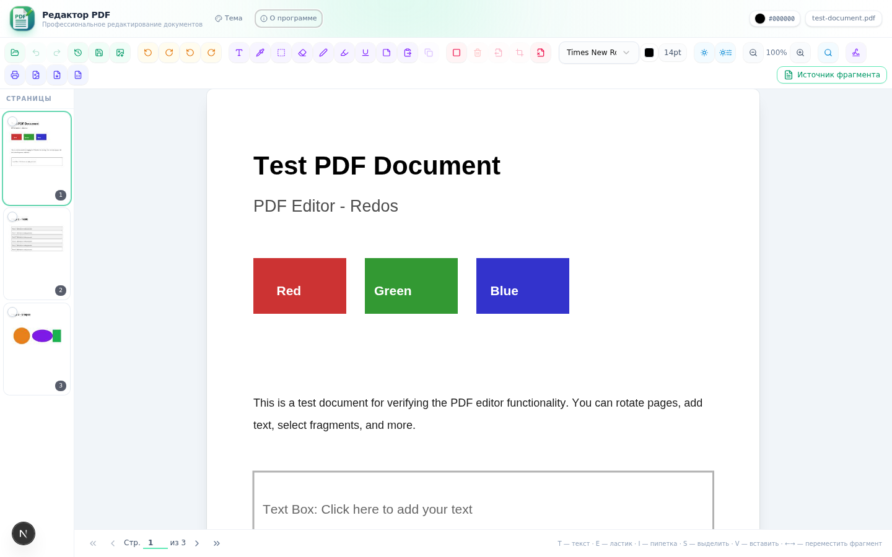

<div align="center">


# Редактор PDF

**Настольный редактор PDF-документов для РЕД ОС**

Слои изменений · Текст и подписи · OCR · Экспорт в Word и Excel

[](https://github.com/flytimopheev-sketch/pdf-editor/releases)
[](LICENSE)
[](#установка)
[](https://www.electronjs.org/)
[](https://nextjs.org/)

</div>

---



## ✨ Возможности

| | |
|---|---|
| 🗂 **Слои изменений** | каждая правка — отдельный слой с историей; исходный документ не изменяется, ничего не сводится в растр |
| ✏️ **Рисование** | перо и ластик с настраиваемой толщиной, палитра цветов, пипетка |
| 🔤 **Текст и подписи** | добавление текста с выбором шрифта и размера, шаблоны подписей для повторной вставки |
| ↩️ **Отмена / Повтор** | полноценная история действий на каждом слое |
| 🔍 **Поиск и OCR** | поиск по тексту и по отсканированным страницам (rus + eng, tesseract) |
| 🔄 **Поворот и выравнивание** | поворот страниц с точностью до 1°, яркость и контраст |
| 💾 **Сохранение и экспорт** | экспорт в PDF, Word (docx) и Excel (xlsx), выбор имени и каталога |
| 🔀 **Второй документ** | параллельная работа с двумя PDF, перенос фрагментов между ними |
| 🖼 **Изображения → PDF** | JPEG и PNG превращаются в PDF в один клик |
| 💽 **Автосохранение сессии** | восстановление документов после перезапуска |
| 🔌 **Работа офлайн** | все данные остаются на компьютере |

## 📦 Установка (РЕД ОС 7.x / 8.x, x86_64)

### Вариант 1 — RPM-пакет

```bash
sudo dnf install ./pdf-editor-2.0.0-1.x86_64.rpm
```

После установки приложение появится в меню приложений
(категория «Офис») с фирменной иконкой.

### Вариант 2 — Tarball

```bash
tar xzf pdf-editor-2.0.0-x86_64.tar.gz
cd pdf-editor-2.0.0-x86_64
sudo ./install.sh
```

Готовые сборки — в разделе [Releases](https://github.com/flytimopheev-sketch/pdf-editor/releases).

## 🛠 Разработка

Требуется [bun](https://bun.sh).

```bash
# зависимости
bun install

# база данных (prisma + sqlite)
bun run db:generate

# режим разработки
bun run dev            # http://localhost:3000

# OCR-сервис (отдельный процесс)
cd mini-services/ocr-service && bun install && bun --hot index.ts
```

### Сборка настольного приложения

```bash
bash build-electron.sh     # Next.js standalone + Electron → dist-electron/ + tar.gz
python3 build-rpm.py       # RPM-пакет (нужен rpmbuild)
```

## 🧩 Структура проекта

```
├── src/
│   ├── app/                    # Next.js App Router (UI, API-маршруты)
│   │   └── api/ocr/            # прокси к OCR-сервису
│   └── components/pdf-editor/  # компоненты редактора
│       ├── toolbar.tsx         # панель инструментов
│       ├── canvas-viewer.tsx   # холст страниц, слои, рисование
│       ├── thumbnail-sidebar.tsx
│       └── save-as-dialog.tsx
├── electron/                   # главный процесс Electron
├── mini-services/ocr-service/  # OCR-микросервис (tesseract.js)
├── ocr-data/                   # языковые модели OCR (rus, eng)
├── prisma/                     # схема БД
├── rpm/                        # spec и иконки для сборки RPM
├── install.sh                  # установщик для РЕД ОС
├── build-electron.sh           # сборка настольного пакета
└── build-rpm.py                # сборка RPM через rpmbuild
```

## 📄 Лицензия

[MIT](LICENSE) © 2026 **flytimopheev**

Вопросы и предложения: <flytimopheev@gmail.com>
