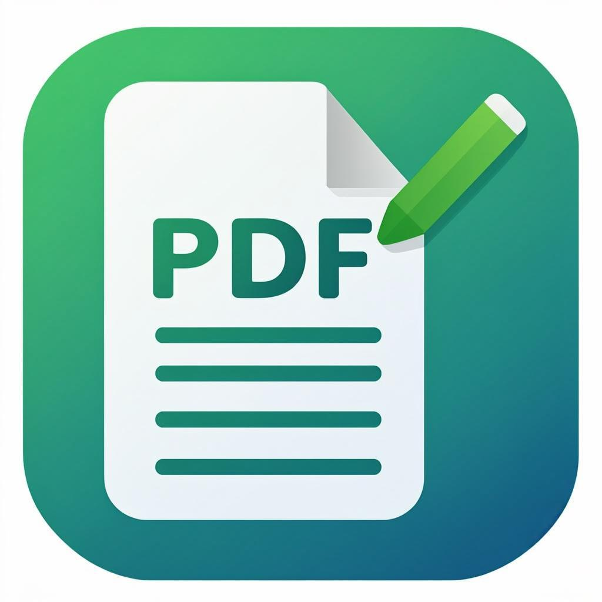
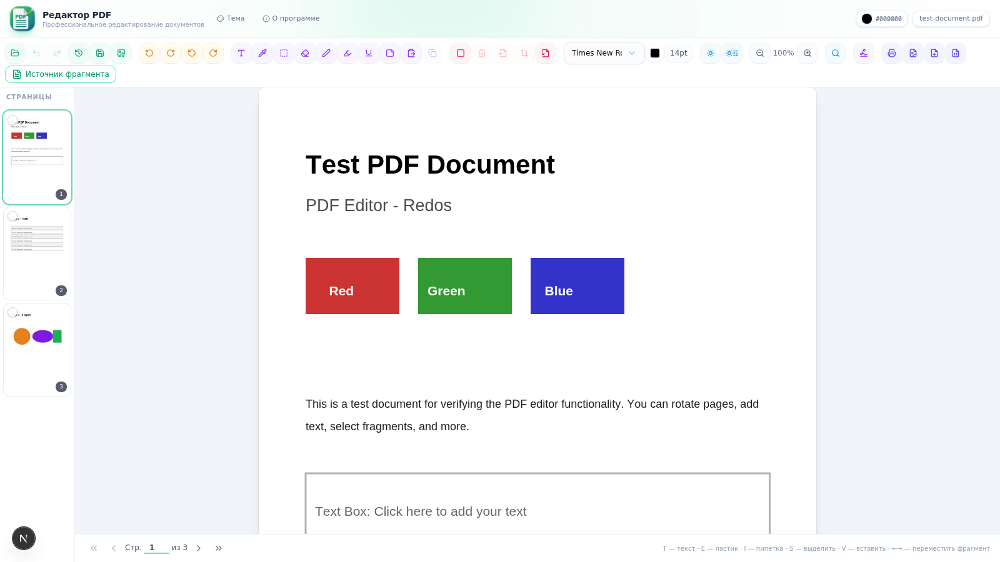

<div align="center">



# Редактор PDF

**Настольный редактор PDF-документов для РЕД ОС**

Профессиональная работа с PDF: слои правок, аннотации, OCR и экспорт — полностью офлайн.

[](https://github.com/flytimopheev-sketch/pdf-editor/releases)
[](LICENSE)
[](#установка)
[](#технологии)
[](https://github.com/flytimopheev-sketch/pdf-editor/pulls)

[Возможности](#-возможности) · [Установка](#-установка) · [Сборка из исходников](#-сборка-из-исходников) · [Структура](#-структура-проекта)



</div>

---

## ✨ Возможности

| | |
|---|---|
| 🗂 **Слои изменений** | Каждая правка — отдельный слой. Оригинал документа не изменяется, правки не сводятся в растр |
| ↩️ **Отмена / Повтор** | Полная история изменений с мгновенным откатом любого действия |
| ✏️ **Перо и ластик** | Рисование от руки: цвет и толщина пера, размер ластика — всё настраивается |
| 🔤 **Текст и заметки** | Добавление текстовых блоков с выбором шрифта и размера |
| ✍️ **Шаблоны подписей** | Сохранение фрагментов как подписей и быстрая вставка в любой документ |
| 🔍 **Поиск** | Поиск по текстовому слою PDF и по отсканированным страницам |
| 🧠 **OCR (рус / eng)** | Распознавание текста на сканах — языковые модели включены в поставку |
| 🔄 **Поворот и обрезка** | Поворот выделенных страниц и целых документов, обрезка полей |
| 🖨 **Предпросмотр печати** | Печать текущей страницы, выбранных или всего документа — с настоящим предпросмотром |
| 🎨 **Темы оформления** | Светлая, тёмная и системная тема интерфейса |
| 💾 **Сохранение PDF** | Экспорт с сохранением всех правок, выбор имени и каталога |
| 📊 **Экспорт Word / Excel** | Конвертация документа в DOCX и XLSX |
| 🔀 **Второй документ** | Режим сравнения и переноса фрагментов между двумя документами |
| 🖼 **JPEG / PNG → PDF** | Изображения превращаются в PDF в один клик |
| 💽 **Автосохранение сессии** | Восстановление документов после перезапуска |
| 🔒 **Офлайн** | Все данные остаются на вашем компьютере |

## 🆕 Что нового в 2.0.2

- **Восстановлены настройки пера и ластика.** У инструментов «Перо» и «Ластик» снова
  появились кнопки настроек: цвет и толщина пера, размер ластика с предпросмотром.
- **Работающие темы оформления.** Светлая, тёмная и системная темы в меню «Тема»;
  выбор запоминается между запусками.
- **Шаблоны подписей.** Сохранить в шаблон можно не только скопированный
  фрагмент, но и подпись, нарисованную пером; шаблоны сохраняются между запусками.
- **Предпросмотр печати.** Кнопка печати открывает диалог предпросмотра:
  текущая страница, выбранные или весь документ, затем системный диалог печати.
- **Справочник горячих клавиш.** Новая кнопка «Клавиши» в шапке — все сочетания
  в одном окне.
- **Второй документ.** Возвращено привычное название режима сравнения двух документов.
- **«О программе» без лишнего:** убран блок автора; версия, лицензия MIT и ссылка
  на исходный код остались. Ссылки открываются в системном браузере, а не в окне
  приложения.

<details>
<summary>Что нового в 2.0.1</summary>

- **Исправлено открытие документов с поворотом.** PDF, у которых ориентация задана
  метаданными `/Rotate`, теперь открываются сразу в правильной ориентации.
- **Исправлено сохранение после поворота.** Поворот на 90°/180°/270° записывается
  в метаданные страницы: размер, поля и качество текста не меняются.
- **Корректные метаданные приложения**, красивый ярлык в меню приложений РЕД ОС.

</details>

## 📦 Установка

### Способ 1 — RPM (РЕД ОС 8, рекомендуется)

```bash
sudo dnf install ./pdf-editor-2.0.2-1.el8.x86_64.rpm
```

Пакет ставит приложение в `/opt/pdf-editor`, иконки всех размеров в `/usr/share/icons/hicolor/`
и ярлык в меню приложений (категория «Офис»).

### Способ 2 — TAR.GZ

```bash
tar xzf pdf-editor-2.0.2-x86_64.tar.gz
cd pdf-editor-2.0.2-x86_64
sudo ./install.sh
```

> Готовые сборки — в разделе [Releases](https://github.com/flytimopheev-sketch/pdf-editor/releases).

### Способ 3 — установочный скрипт

```bash
sudo bash install.sh
```

## 🛠 Сборка из исходников

Требуется [bun](https://bun.sh) ≥ 1.1 и Node.js ≥ 20.

```bash
# 1. Зависимости
bun install

# 2. Запуск в режиме разработки (http://localhost:3000)
bun run dev

# 3. Сборка настольного приложения
bun run build
bash build-electron.sh     # → dist-electron/pdf-editor-2.0.2-x86_64/

# 4. Сборка RPM (нужен rpmbuild; проверено на rpm 4.14 — РЕД ОС 8)
python3 build-rpm.py       # → pdf-editor-2.0.2-1.el8.x86_64.rpm
```

OCR-сервис запускается отдельно (используется приложением автоматически):

```bash
cd mini-services/ocr-service
bun install
bun --hot index.ts         # порт 3011
```

## 🧰 Технологии

<div align="center">


</div>

| Компонент | Технология |
|---|---|
| Интерфейс | Next.js 16 (App Router), React 19, TypeScript, Tailwind CSS 4, shadcn/ui |
| Рендеринг PDF | pdf.js (`pdfjs-dist`) |
| Настольная оболочка | Electron 33 |
| Настройки и сессии | Prisma + SQLite |
| OCR | tesseract.js — мини-сервис `mini-services/ocr-service` (русский, английский) |
| Экспорт | docx, xlsx |
| Пакетный менеджер | bun |

## 📁 Структура проекта

```
├── src/
│   ├── app/                        # Страницы и API-маршруты (save, ocr, export)
│   └── components/pdf-editor/      # Компоненты редактора: тулбар, канвас, миниатюры
├── electron/                       # Главный процесс Electron (окно, меню, печать)
├── mini-services/ocr-service/      # OCR-микросервис на tesseract (порт 3011)
├── ocr-data/                       # Языковые модели tesseract (rus.traineddata, eng.traineddata)
├── prisma/                         # Схема БД (настройки, сессии)
├── rpm/                            # Spec-файл RPM (совместим с rpm 4.14 / РЕД ОС 8)
├── public/                         # Иконки, статика
├── docs/screenshots/               # Скриншоты для README
├── install.sh                      # Установщик для РЕД ОС
├── build-electron.sh               # Сборка Electron-пакета
└── build-rpm.py                    # Сборка RPM
```

## 🚀 Ключевые особенности реализации

- **Правки не разрушают оригинал** — исходные страницы PDF рендерятся pdf.js, а все
  изменения (перо, текст, подписи) живут в слоях поверх и сохраняются отдельно.
  При экспорте слои накладываются на оригинал в нужном порядке.
- **RPM собирается в окружении AlmaLinux 8** (rpm 4.14.3) — пакеты совместимы с РЕД ОС 8
  и не содержат новых форматов тегов, которые не понимает системный rpm.
- **OCR вынесен в мини-сервис** — распознавание не блокирует интерфейс редактора.

## 📄 Лицензия

[MIT](LICENSE) © 2026 [flytimopheev](https://github.com/flytimopheev-sketch)

Обратная связь: [flytimopheev@gmail.com](mailto:flytimopheev@gmail.com)
